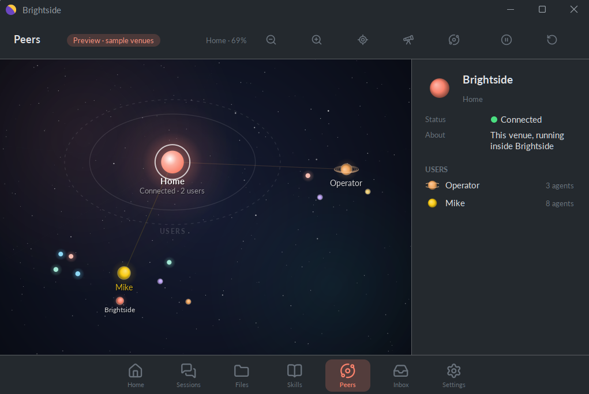

<div align="center">

# ☀️ Brightside

**Your own agent. On your own machine. Under your own identity.**

*And it writes its own skills.*

[](LICENSE)
[](https://adoptium.net/)
[](https://covia.ai)
[](#where-this-is-going)

</div>

---

Picture an assistant that is actually yours. It lives on your computer, not in
someone else's cloud. It knows your name because you told it, and nothing about
you leaves the house unless you send it. It remembers yesterday. It learns how
you like things done and keeps that as a skill of its own. And when something
is your call, it asks you, and waits.

That is Brightside. There is no account to create, no server to trust, no
telemetry. Everything it is — your conversations, its memory, every skill it
learns — sits in one folder on your disk that you can read, back up or delete.

<div align="center">



</div>

## What it's like

**It's yours.** It runs under a name you chose and answers to you alone. The
only thing that ever leaves your machine is the model call you asked for, sent
to the provider whose key you gave it.

**It grows.** Most assistants are frozen at the shape their vendor shipped.
Yours writes its own skills. Show it how you like your weekly report done, and
it can keep that as something it reaches for next time. Hand it a skill someone
else wrote — a [`SKILL.md`](https://agentskills.io) folder dropped into
`~/.brightside/skills/`, the same open format Claude Code and a dozen other
agents use — and it learns that too, on its next start.

**It remembers.** A private memory carries across every conversation, so it
feels like your assistant and not a stranger every morning. Every past
conversation is a click away, and it can read its own history when you ask
what you talked about last week.

**It has a team.** Your assistant stays ordinary on purpose: it reads untrusted
content all day, so it never holds the keys. Three super-user agents do —
**Odin** the administrator, **Thor** the guardian and **Njord** the treasurer.
They answer to you alone, check one another, and bring any decision that is
yours to your Inbox ([docs/GODS.md](docs/GODS.md)).

**You stay in the loop.** Power is gated, not absent. Reading and remembering
are always on; writing, the web, your files and other agents each arrive with
the skill that carries them. When an agent needs an approval or a missing
detail, it asks, and only you can answer. An agent can never approve its own
request.

**It meets you where you are.** Talk to it from your phone over Discord, or out
loud at your desk. Hand it coding work and it runs Claude Code on your projects
— including its own source, so it can improve itself. Other tools can reach it
too: it speaks MCP, on your own machine only.

**No jargon in the way.** The everyday screens say "your assistant", "your
name", "memory". The machinery is all still there for the curious, one click
away under Settings — down to the exact bytes the model saw.

## Where this is going

An agent that runs only on your own machine is a private tool. An agent that
can meet other people's agents — under an identity that is yours, with
authority you granted and money you allowed — is something else entirely.

Every other local-first assistant is an isolated singleton wearing its owner's
API key. Two of them, belonging to two different people, have no way to
establish who the other is, to agree to anything or to settle up. Brightside
is built for the second kind. Your agent has an identity it can prove, only
the authority you gave it, and a treasurer who can pay — so when it meets
another agent, who they are, what they agree and how they settle up is
protocol, not somebody's platform. That is not something that can be bolted on
later. The Peers view above is the first piece. Next:

- **Federation** — share a skill, delegate to a friend's agent, reach a remote
  tool, without giving up ownership of your own state
  ([docs/NETWORK.md](docs/NETWORK.md))
- **More channels** — Telegram and the rest, set up as easily as Discord
- **Native installers** — a signed app per platform instead of `java -jar`
- **Richer messages** — images, cards and structured tool output in the
  conversation
- **Local models** — a genuinely offline default
- **Skill sharing** — import, export and review the skills your agent wrote

Ideas and disagreement are welcome — open an issue.

## Try it

You need **Java 21+** (25 recommended) and **Maven 3.7+**.

```bash
git clone https://github.com/covia-ai/brightside.git
cd brightside
mvn package
java -jar target/brightside.jar
```

First launch takes a minute: choose a passphrase, write down a recovery
phrase, pick a model and paste its key, and say what it should call you. Then
you are talking to your agent. No key to hand? Choose the offline echo bot; the
app works end to end, the replies are just echoes.

**Enter** sends and **Shift+Enter** starts a new line. Right-click a message, a
conversation or an agent for what you can do with it; everything else is under
**Settings**.

<details>
<summary><b>Building against a local Covia checkout</b></summary>

`covia.version` in `pom.xml` names the Covia line. A release resolves from
Maven Central; a SNAPSHOT needs the Covia checkout installed locally:

```bash
cd ../covia && mvn clean install -DskipTests
```

Convex comes in through Covia as a Maven Central release, so `../convex`
needs installing first (`mvn clean install -DskipTests` there too) only while
Covia's own `convex.version` is a SNAPSHOT. If the build cannot resolve
`ai.covia:venue`, that is why.
</details>

## Under the hood

Brightside is not a wrapper around a chat box. It runs a complete
[Covia](https://covia.ai) venue — engine, tools, encrypted state, an agent
framework and an MCP/A2A/HTTP surface — inside its own process, with a quiet
desktop app in front. The venue binds to loopback only. Skills are data, not
code, which is what lets the assistant write its own. Configuration is one
JSON5 file in which every key is optional.

- [docs/DESIGN.md](docs/DESIGN.md) — the product principles
- [docs/ARCHITECTURE.md](docs/ARCHITECTURE.md) — the shape and the decisions behind it
- [docs/SKILLS.md](docs/SKILLS.md) — how the assistant gets its abilities
- [docs/GODS.md](docs/GODS.md) — the team of super-user agents
- [docs/SECURITY.md](docs/SECURITY.md) — keys, recovery and what is encrypted
- [docs/CONFIGURATION.md](docs/CONFIGURATION.md) — every file and setting, and reaching your agent from other tools
- [docs/NETWORK.md](docs/NETWORK.md) — where this is going

## Good to know

**Does it phone home?** No. No telemetry, no accounts, no hosted dependency.
The only outbound traffic is the model call you configured.

**Which models?** Pick one from the catalogue under *Settings → Model*. The
default is Anthropic's Claude.

**Where is my data?** In `~/.brightside/`: an encrypted store holding your
conversations, memory, skills and keys, beside your settings file and logs.
Back the folder up; delete it to start over completely
([docs/CONFIGURATION.md](docs/CONFIGURATION.md)).

**Can it run offline?** Everything but the model. Point it at a local model to
close that gap, or at the echo bot.

**Can other tools reach it?** Yes — that is rather the point. HTTP, MCP and
A2A, on your own machine ([docs/CONFIGURATION.md](docs/CONFIGURATION.md)).

**Is it production-ready?** Not yet. It is an early preview: in daily use by
its author, moving quickly, and pre-1.0 in the way that implies.

## Join in

Contributions are very welcome, especially now.

```bash
mvn test      # boots real venues, headless; no API key needed
mvn package   # → target/brightside.jar
```

Branch from `develop` and PR into it. [AGENTS.md](AGENTS.md) is the short
guide for anyone — human or AI — working here; read it and
[docs/DESIGN.md](docs/DESIGN.md) before a first PR. The `docs/` folder explains
*why* things are the way they are.

## Licence

Eclipse Public License 2.0 — see [LICENSE](LICENSE).

Built on the [Covia Grid](https://covia.ai) and [Convex](https://convex.world).
